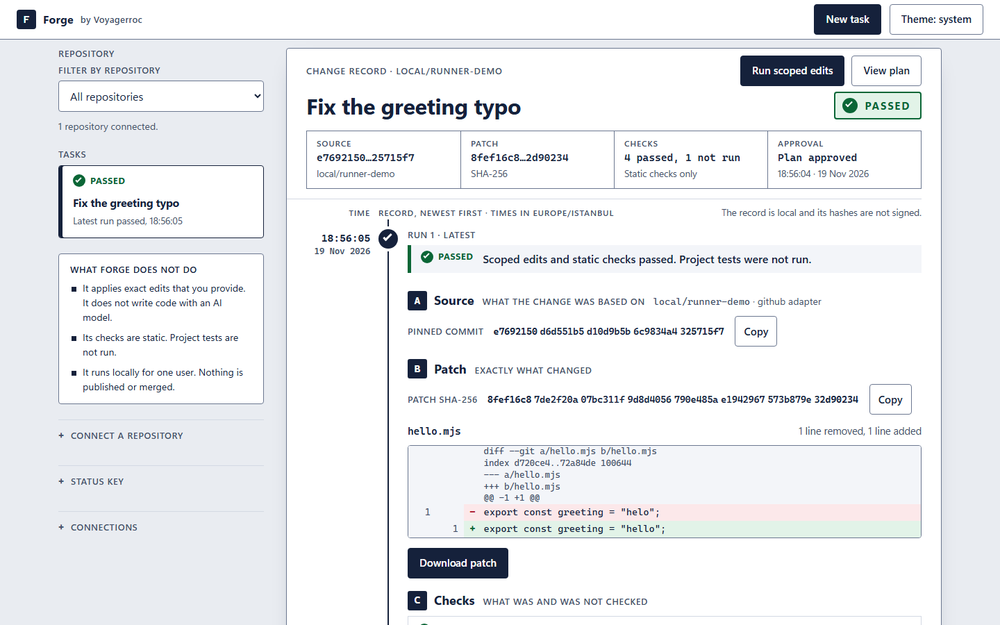
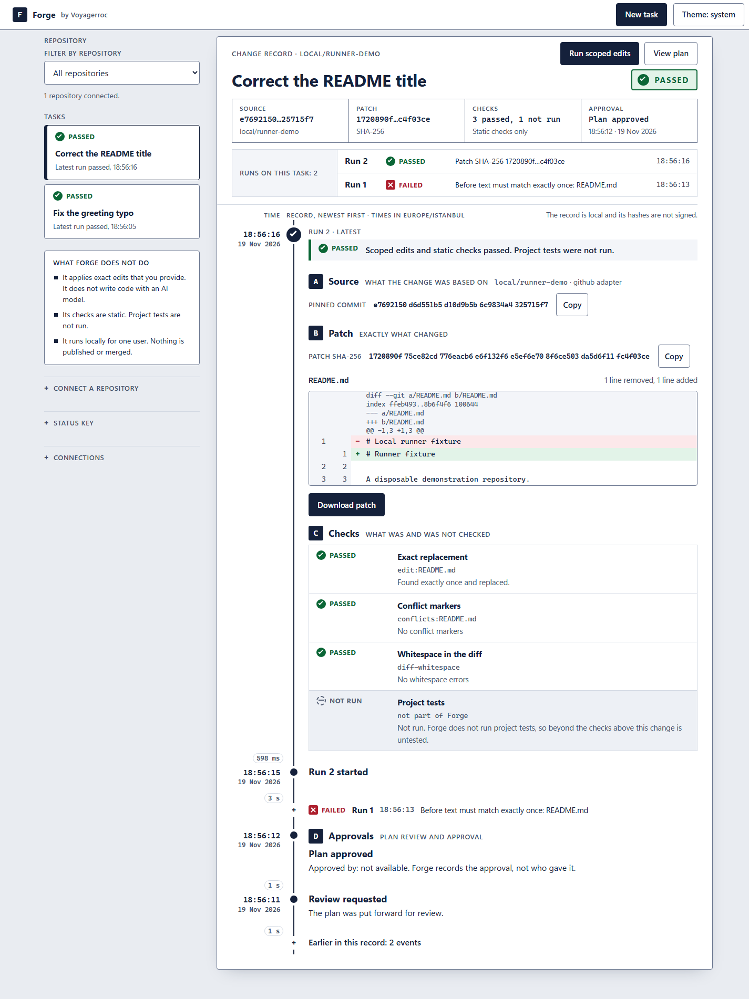
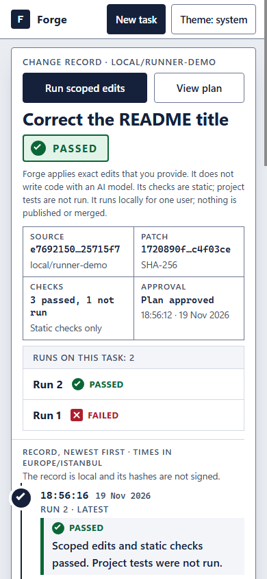
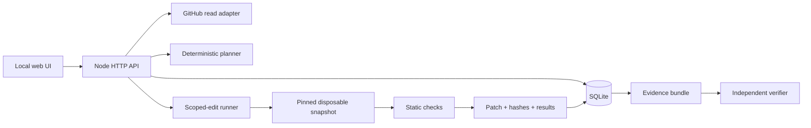

<div align="center">

# Voyagerroc Forge

### A change that carries its own proof.

Writing a change has become cheap. Trusting it has not. Forge records each change together with what it was based on, exactly what changed, what was checked, what was not checked, and when its plan was approved. Anyone can re-check that record without trusting whoever produced it.

**Status:** v0.3.0 pre-release · MIT · single user · local only

[](https://github.com/Voyagerroc/voyagerroc-forge/actions/workflows/ci.yml)

[Try it in two minutes](#try-it-in-two-minutes) · [Check the evidence yourself](#check-the-evidence-yourself) · [Roadmap](ROADMAP.md) · [Contribute](CONTRIBUTING.md)

</div>



## Try it in two minutes

Requires **Node.js 24.19+** and **Git** on your PATH. No API key, account, Docker or npm install is needed.

```sh
git clone https://github.com/Voyagerroc/voyagerroc-forge.git
cd voyagerroc-forge
npm run demo:runner
```

Open **http://127.0.0.1:4317**. If that port is taken, start with `PORT=4318 npm run demo:runner` (PowerShell: `$env:PORT=4318; npm run demo:runner`) and open that port instead.

1. Choose **New task**. Pick **local/runner-demo**, enter a title and the intent, keep the **GitHub** adapter and choose **Create task**.
2. In the change record, choose **Generate plan**, then **Request review**, then **Approve plan**. Nothing is run or published by these steps.
3. Choose **Run scoped edits**, paste the following and choose **Run edits & static checks**:

```json
[{"path":"hello.mjs","before":"\"helo\"","after":"\"hello\""}]
```

4. The record now shows the run as **Passed** and four parts: **Source** (the pinned commit), **Patch** (the diff and its SHA-256, with **Download patch**), **Checks** (what was and was not checked) and **Approvals** (when the plan was approved).

The demo repository stays unchanged, so you can repeat the exercise. To see a failure, run the edits above with `"before":"\"not-present\""` first. That run is recorded as **Failed** with no patch. Then run the corrected edits: the record lists both runs, and the failed one keeps its evidence. See the [failed edit walkthrough](docs/DEVELOPMENT.md#failed-edit-and-corrected-follow-up).

Stop the server with Ctrl+C. `npm start` starts the ordinary workspace without the demo source.



On a narrow screen the record keeps the same order:



## Check the evidence yourself

A finished run can be exported as a portable bundle and checked by someone who does not trust the server that produced it. With the demo still running, take the run id from the `runs` list of `GET /api/state` (open http://127.0.0.1:4317/api/state), then:

```sh
npm run evidence:export -- --run <run id> --out evidence.json
npm run evidence:verify -- evidence.json --repo data/demo-repository
```

This is the output of those commands for a passed demo run (the commit and times differ on every machine):

```text
CLAIM                         RESULT                   DETAIL
bundle format                 MATCH                    unsigned in-toto Statement v1 with a Forge predicate v1; not signed, so origin is not proven
subject name                  MATCH                    local/runner-demo@7f5c3a847c5146b1fbc639a0595fca016fff3e8e.patch
patch SHA-256                 MATCH                    8fef16c87de2f20a07bc311f9d8d4056790e485ae1942967573b879e32d90234
patch size                    MATCH                    176 bytes
subject digest                MATCH                    subject digest equals the recorded patch hash
run status matches checks     MATCH                    a passed run records a patch, checks and no failed check
internal consistency          MATCH                    status, patch, base commit, approval time and check names do not contradict each other
base commit                   MATCH                    7f5c3a847c5146b1fbc639a0595fca016fff3e8e exists in this repository
patch applies to base commit  MATCH                    applies cleanly to 7f5c3a847c5146b1fbc639a0595fca016fff3e8e; 1 file changed
check edit:hello.mjs          MATCH                    recorded and re-run: passed
check conflicts:hello.mjs     MATCH                    recorded and re-run: passed
check syntax:hello.mjs        MATCH                    recorded and re-run: passed
check diff-whitespace         MATCH                    recorded and re-run: passed
repository name               RECORDED NOT VERIFIABLE  local/runner-demo (local); a Git repository does not know its name
intent                        RECORDED NOT VERIFIABLE  task title and text are what the Forge server stored
plan approval time            RECORDED NOT VERIFIABLE  2026-11-19T16:32:54.960Z; the bundle records the time only, and no one can recompute it
run timestamps and events     RECORDED NOT VERIFIABLE  6 events and the run start and finish times are the server's own clock
run summary                   RECORDED NOT VERIFIABLE  free text written by the server
tool version                  RECORDED NOT VERIFIABLE  voyagerroc-forge 0.3.0

13 matched, 0 mismatched, 6 recorded not verifiable. The bundle is not signed: matches show that it is consistent, not who produced it.
```

The verifier exits with `0` only when every verifiable claim matches. It re-applies the patch to the pinned commit and re-runs the static checks itself. What it cannot recompute, such as the intent text and the times, it lists as recorded, not verifiable. Details, the file format and the threat model: [docs/EVIDENCE.md](docs/EVIDENCE.md).

## What Forge does not do

- It applies exact edits that you provide. It does not write code with an AI model.
- Its checks are static: exact replacement, JSON validity, JavaScript syntax, conflict markers and whitespace. Project tests are not run.
- It runs locally for one user, on the loopback address. There is no login and no hosted service.
- The evidence bundle is not signed. It proves consistency, not origin.
- Nothing is published to GitHub or merged. GitHub access is read-only.
- Node permissions are guardrails for the trusted worker, not a sandbox for malicious code. Repository code is parsed as data and never executed. Do not expose the server publicly. See [SECURITY.md](SECURITY.md).

The runner accepts 1–20 edits and snapshots of up to 200 regular tracked files, 1 MiB per file and 10 MiB total content. Symlinks, submodules and binary edits are unsupported. A passing run means the listed static checks passed; semantic correctness is not implied.

## What you can build on

| Building block | Implemented today |
| --- | --- |
| Change record | One page per change: source, patch, checks, approvals and runs, with times in the viewer's time zone |
| Evidence bundle | `npm run evidence:export`, `npm run evidence:verify`, `GET /api/runs/<run id>/evidence` |
| Workflow | Intent → plan → review → approval, with optimistic concurrency guards |
| GitHub integration | Public metadata, fresh revision resolution, optional read-only GitHub App auth |
| Source snapshots | Pinned commits from small public repositories or configured local Git sources |
| Scoped runner | Explicit UTF-8 edits in a disposable copy; the source repository is not changed |
| Static checks | Exact replacement, JSON validity, JS syntax, conflict markers and whitespace |
| Lifecycle | Bounded processes, cancellation, descendant termination and restart recovery |
| Events | Per-task recorded events in the state response; HMAC-verified GitHub webhooks with deduplication |
| Storage | SQLite in WAL mode |



Start with [`Runner`](src/runner.mjs), [`evidence`](src/evidence.mjs), [`GitHubAdapter`](src/github.mjs), [`openStore`](src/store.mjs), the [architecture notes](docs/ARCHITECTURE.md) or the proposed [adapter contract](docs/ADAPTER-CONTRACT.md). The contract is a design proposal, not a stable plugin SDK.

## Where the project is going

These are plans, not features. See the [roadmap](ROADMAP.md).

- Produce the evidence inside the maintainer's own GitHub Actions run and attach it to a pull request.
- Sign the evidence through existing standards (GitHub artifact attestations, Sigstore) instead of a format of its own.
- Import a patch that was produced outside Forge.
- An OS-isolated execution backend ([issue #6](https://github.com/Voyagerroc/voyagerroc-forge/issues/6)) before any project test is run.

## Contribute

Five outside contributors have had eleven pull requests merged. Good pull requests are small, come with a failing test first where a rule changes, and show the commands you ran with their real results. Start with the [try it](#try-it-in-two-minutes) steps and report anything that confused you, pick an issue by [label](https://github.com/Voyagerroc/voyagerroc-forge/labels), or ask in an issue before starting something large. The maintainer answers within 72 hours. Read [CONTRIBUTING.md](CONTRIBUTING.md) and the [code of conduct](CODE_OF_CONDUCT.md). No CLA or DCO sign-off is required; contributions are under the MIT license.

## Development

```sh
npm run check
npm run dev
```

`npm run check` checks local documentation links, syntax and runs Node's built-in tests; no package installation is needed. The [read-only CI workflow](.github/workflows/ci.yml) runs it on clean Ubuntu and Windows runners with Node.js 24.19.0. Check the workflow result for the revision under review; a configured workflow is not itself a passing result. Optional browser acceptance scripts need Playwright: see [development and verification](docs/DEVELOPMENT.md). Configuration, GitHub App setup, webhooks and source mappings: [CONFIGURATION.md](docs/CONFIGURATION.md). `.env.example` is a reference; `.env` is not loaded automatically.

## License

[MIT](LICENSE).

---

Made by Erol Tasci at [Voyagerroc Technologies](https://voyagerroctechnologies.com/) · [voyagerroctechnologies.com](https://voyagerroctechnologies.com/)
