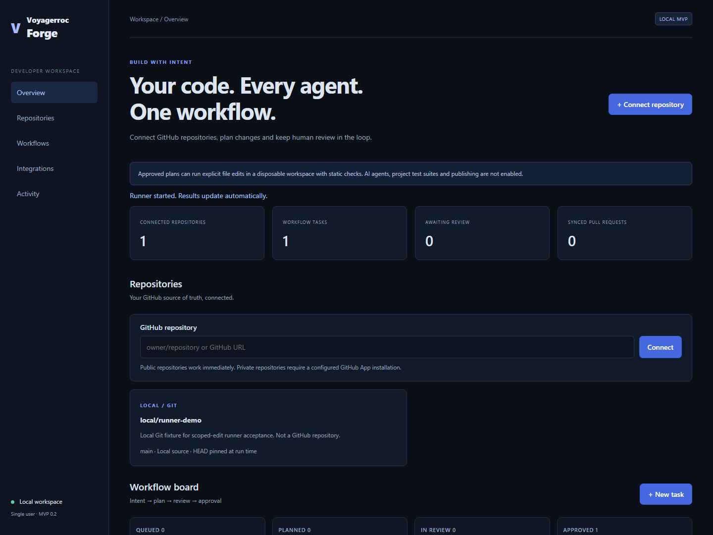
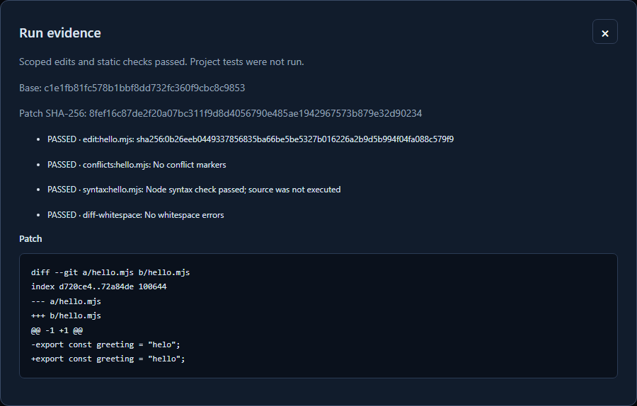
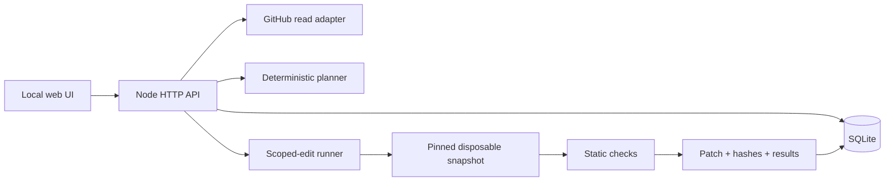

<div align="center">

# Voyagerroc Forge

### Turn intent into a patch you can inspect.

An experimental, GitHub-connected framework starter for reviewable agent workflows.

[](docs/DEVELOPMENT.md)
[](LICENSE)
[](https://nodejs.org/)
[](#project-status)

**No npm runtime dependencies · Local-first · GitHub stays the source of truth**

[Try the demo](#try-it-in-two-minutes) · [Architecture](docs/ARCHITECTURE.md) · [Roadmap](ROADMAP.md) · [Find your first contribution](https://github.com/Voyagerroc/voyagerroc-forge/contribute)

</div>



## Why Forge?

A coding workflow should leave more than a reassuring message. You should be able to inspect **which source revision was used, what changed, what was checked, and what still needs review**.

Forge starts with that evidence trail. Connect a repository, describe an intent, review a plan, apply explicit file edits in a disposable copy, then inspect the actual patch and named check results. The extension direction is interchangeable source-control and execution adapters, with human review before publication.

The current runner applies exact edits you provide. It does **not** generate code with an AI model. That boundary is visible in the UI and API.

## Try it in two minutes

Requires **Node.js 24.19+** and **Git** on your PATH. No API key, paid account, Docker or npm install is needed for the local demo.

```sh
git clone https://github.com/Voyagerroc/voyagerroc-forge.git
cd voyagerroc-forge
npm run demo:runner
```

Open **http://127.0.0.1:4317**:

1. Create a task for **local/runner-demo** using the GitHub adapter.
2. Generate its plan, request review, then approve the plan.
3. Choose **Run scoped edits** and paste:

```json
[{"path":"hello.mjs","before":"\"helo\"","after":"\"hello\""}]
```

4. Open **View evidence** to inspect the real diff, pinned commit and check results.

The original demo repository stays unchanged, so the exercise is repeatable. Stop the server with Ctrl+C. Use `PORT` if 4317 is already occupied. `npm start` starts the ordinary workspace without enabling the local demo source.



## What you can build on

| Building block | Implemented today |
| --- | --- |
| GitHub integration | Public metadata, fresh revision resolution, optional read-only GitHub App auth |
| Workflow | Intent → plan → review → approval, with optimistic concurrency guards |
| Source snapshots | Pinned commits from small public repos or configured local Git sources |
| Scoped runner | Explicit UTF-8 edits in a disposable copy; no upstream mutation |
| Evidence | Actual diff, patch SHA-256, named checks, timestamps and run status |
| Static checks | Exact replacement, JSON validity, JS syntax, conflict markers and whitespace |
| Lifecycle | Bounded processes, cancellation, descendant termination and restart recovery |
| GitHub events | HMAC-verified webhooks, deduplication and PR snapshot ordering |
| Storage and UI | SQLite WAL, responsive UI and inspectable results |

## Architecture



Start with [`Runner`](src/runner.mjs), [`GitHubAdapter`](src/github.mjs), [`openStore`](src/store.mjs), or the proposed [adapter contract](docs/ADAPTER-CONTRACT.md). The contract is a design proposal, not a stable plugin SDK.

## Project status

**v0.2.0 prototype — working foundations, open design space.**

AI coding harnesses, container/VM-isolated project tests, draft PR publication, login/teams, durable queues and hosted operation are on the [roadmap](ROADMAP.md). `open_scion` and Google Scion adapters are explicitly **planned**; no compatibility is claimed. Forge is independent of GitHub, Anthropic and Google.

This is single-user, loopback-only software. Node permissions are guardrails for the trusted worker, not a sandbox for malicious code. Repository code is parsed as data and never executed. Do not expose the current server as a public multi-user service or add arbitrary agent/test commands without an OS isolation backend. See [security boundaries](SECURITY.md).

The scoped runner accepts 1–20 edits and snapshots of up to 200 regular tracked files, 1 MiB per file and 10 MiB total content. Symlinks, submodules and binary edits are unsupported. A passing run means the listed **static checks** passed; project tests and semantic correctness are not implied.

## Contribute a small piece

We welcome the first contributors: developers interested in GitHub tooling, Node.js, source control, execution isolation, and review UX.

- **Try the demo and report friction.** A minimal reproduction is useful even without a patch.
- **Pick a [good first issue](https://github.com/Voyagerroc/voyagerroc-forge/issues?q=is%3Aissue%20is%3Aopen%20label%3A%22good%20first%20issue%22).** Starter issues include scope and acceptance criteria.
- **Propose an adapter.** Start with capabilities, failure modes and fixture evidence before a large implementation.
- **Send a focused PR.** Explain the trigger, resulting behavior and validation. Draft PRs are welcome.

Read [CONTRIBUTING.md](CONTRIBUTING.md), [CODE_OF_CONDUCT.md](CODE_OF_CONDUCT.md), and the [roadmap](ROADMAP.md). No CLA or DCO sign-off is currently required; contributions are under the repository's MIT license.

## Development

```sh
npm run check
npm run dev
```

The offline check command uses Node's built-in test runner; no package installation is needed. A Linux/Windows CI template is included; automatic CI is not activated yet because the publishing credential lacks workflow permission. Optional browser acceptance scripts require Playwright; see [development and verification](docs/DEVELOPMENT.md).

Configuration, GitHub App setup, webhook boundaries and source mappings: [CONFIGURATION.md](docs/CONFIGURATION.md). `.env.example` is a reference; `.env` is not loaded automatically.

## License and attribution

[MIT](LICENSE). Created by [Erol Taşcı](https://github.com/Voyagerroc) at [Voyagerroc Technologies](https://voyagerroctechnologies.com/).
