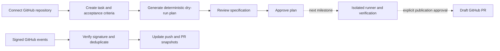
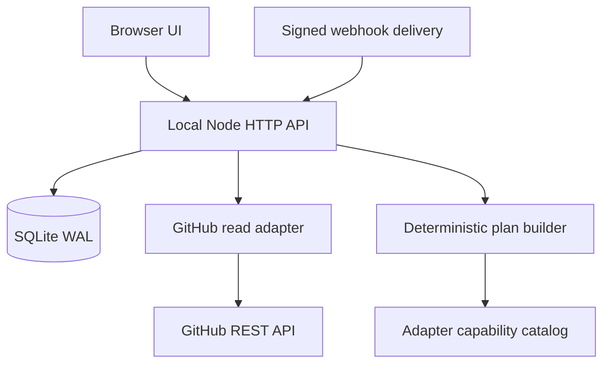

# MVP workflow and delivery plan

Current milestone: v0.2 now implements disposable pinned source workspaces, explicit file edits, real static checks, persisted diffs and cancellation. The plan approval stages below remain distinct from execution results. See [Runner delivery and boundaries](RUNNER-2026-10-28.md). The original v0.1 validation notes below are historical.

## Product slice

Primary user: a developer coordinating coding agents while keeping GitHub as the source of truth. First acceptance journey: connect a repository → describe intent → inspect workflow plan → request review → approve the plan → inspect an auditable activity record. Real execution and publication are a second slice.

## Implemented architecture

Data model: Project (GitHub numeric identity, canonical name, branch, latest observed SHA), Task (intent, adapter, status, optimistic version, plan), Event (kind, detail, timestamp), Delivery (idempotency ID), PullRequest (number, state, title, head SHA, updated timestamp). SQLite transactions atomically persist state + audit event and webhook state + delivery receipt.

## State semantics

| State | Meaning | Allowed next operation |
| --- | --- | --- |
| queued | Intent saved; no plan yet | Generate plan |
| planned | Deterministic workflow spec available | Request review |
| in_review | Specification awaiting local human decision | Approve plan |
| approved | Specification approved; execution not started | Future runner integration |

Scion adapters may be selected to explore a plan, but remain labeled `planned`. No adapter selection grants an unimplemented capability. Approval must not later be silently repurposed as permission to publish; add an explicit publication approval referencing the verified patch SHA.

## Next implementation milestones

1. **Runner spike:** validate one supported harness in a disposable sandbox. Pin base SHA, isolate workspace, bound runtime/resources and redact logs. Capture patch + actual checks. Cancellation must stop descendants and release workspace. Never execute arbitrary repository code inside the HTTP server.
2. **GitHub write integration:** add least-privilege App permissions only when needed. Create a separate branch and draft PR, use task/patch idempotency keys, reconcile ambiguous timeout outcomes, protect default branch and never force-push or auto-merge. Require explicit publication approval for the exact patch.
3. **open_scion compatibility spike:** build a pinned revision in a disposable Linux environment, verify license/limits and real RPC contract. Compare checkout/query/changeset results against fixture repositories. Do not invent wire endpoints from the README. Keep GitHub authoritative until round-trip mappings are proven.
4. **Scion orchestration spike:** validate one version's CLI/API lifecycle and authentication. Implement start, status, logs, cancellation and error mapping behind the runner contract. Do not confuse it with source-control Scion.
5. **Hosted pilot:** user login, installation ownership verification, tenant-scoped DB access, roles, secret store, migrations/backups, durable queue, resource budgets, trusted webhook ingress, retries/reconciliation, operational monitoring and deletion/export. Move from local SQLite only if hosting/concurrency requirements justify it.

A full GitHub competitor (native repository hosting, distributed object storage, code search, reviews, issue trackers and CI at scale) is beyond today's scaffold. Pilot this workflow first, then select the smallest differentiated capability supported by actual use.

## Completed validation loops

1. API/persistence/integration tests: initial 11/12. Windows test cleanup attempted removal before database close; fixed test teardown ordering.
2. Re-run: 12/12 passed. Browser: actual public GitHub import; create → plan → review → approve → refresh persisted. No JS errors; 390 px viewport no horizontal overflow.
3. Visual inspection and documentation: desktop screenshot inspected, adapter statuses and execution limits explicit; no deployment or upstream changes. Graphify code graph created.

Artifacts: `qa/desktop.png`, `qa/mobile.png`, `qa/browser-result.json` (local ignored QA output). Start with `npm start`; run checks with `npm run check`.
